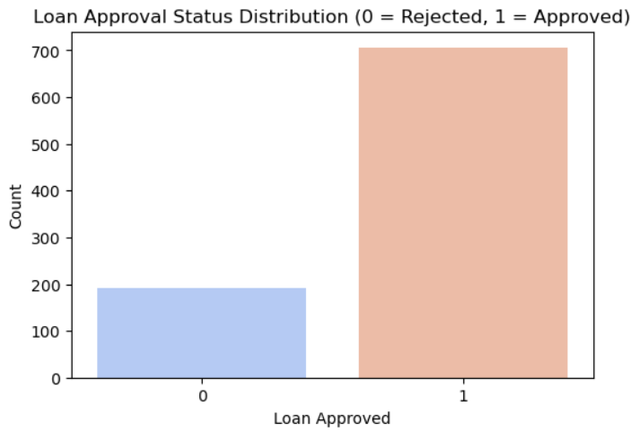
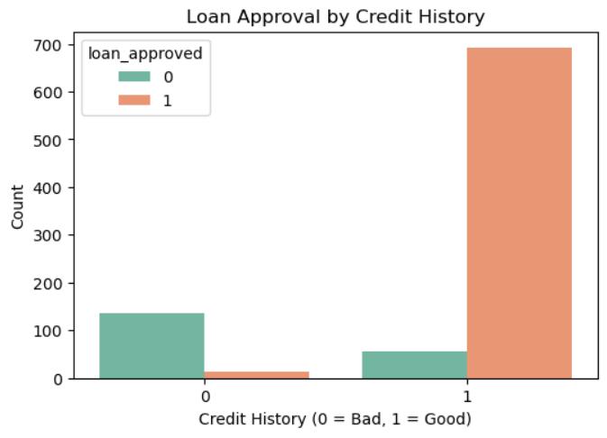
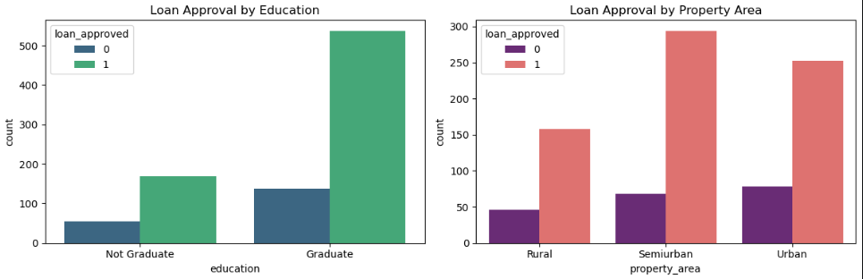
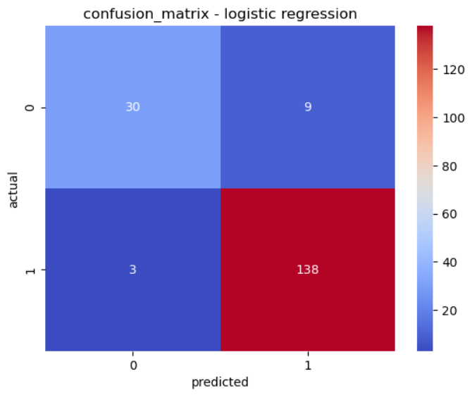
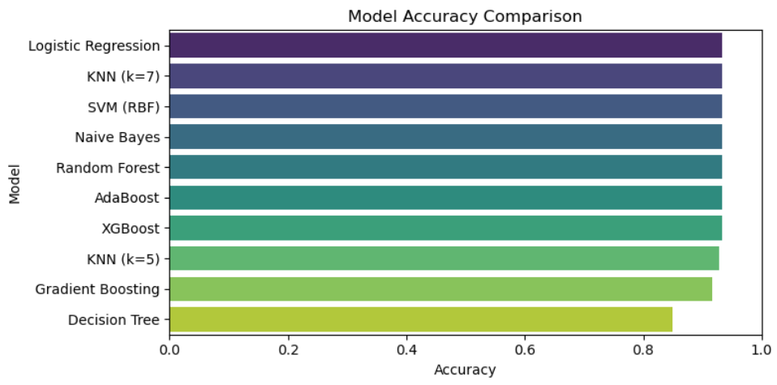

# Bank Loan Approval Prediction – EDA & Classification

## Project Overview

This project focuses on predicting whether a bank loan application will be approved or rejected using machine learning classification algorithms

It includes exploratory data analysis (EDA), data preprocessing, model training, and performance comparison to understand how different classification algorithms perform on the dataset.

## Dataset Information

- **Dataset:** Bank Loan Approval Dataset
- **Target Variable:** `loan_approved`
- **Target Classes:**
  - `0` – Loan Rejected
  - `1` – Loan Approved

## Exploratory Data Analysis (EDA)

EDA was performed to understand the dataset, identify patterns, and explore relationships between applicant details and loan approval.

### 1. Loan Approval Distribution



### 2. Credit History Analysis



### 3. Education and Property Area Analysis



### 4. Income and Loan Amount Analysis

Histograms and boxplots were used to understand the distributions of applicant income and loan amounts and identify possible outliers.

### 5. Correlation Analysis

A correlation heatmap was used to examine relationships between numerical features. Credit history showed a strong positive correlation with loan approval.

## Data Preprocessing

The following preprocessing steps were performed:

- Handling missing values
- Removing duplicate records where applicable
- Encoding categorical variables
- Preparing features and target variable
- Splitting the dataset into training and testing sets

## Machine Learning Algorithms

The following classification algorithms were implemented and compared:

1. Logistic Regression
2. K-Nearest Neighbors (KNN – k=5)
3. K-Nearest Neighbors (KNN – k=7)
4. Support Vector Machine (SVM)
5. Gaussian Naive Bayes
6. Decision Tree
7. Random Forest
8. Gradient Boosting
9. AdaBoost
10. XGBoost

## Model Evaluation

Models were evaluated using the following metrics:

- Accuracy
- Precision
- Recall
- F1-score
- Confusion Matrix

### Logistic Regression – Confusion Matrix



### Model Accuracy Comparison



## Key Observations

- Credit history showed a strong relationship with loan approval.
- Applicant income and loan amount were explored to understand their distributions and patterns.
- Different classification algorithms were compared to evaluate their predictive performance.
- Accuracy alone was not considered sufficient; precision, recall, and F1-score were also examined.

## Technologies Used

- Python
- Pandas
- NumPy
- Matplotlib
- Seaborn
- Scikit-learn
- XGBoost
- Jupyter Notebook

## Project Structure

```text
bank-loan-approval-prediction/
│
├── images/
│   ├── loan-approval-distribution.png
│   ├── credit-history-analysis.png
│   ├── education-property-analysis.png
│   ├── logistic-regression-confusion-matrix.png
│   └── model-accuracy-comparison.png
│
├── bank-loan-approval-prediction.ipynb
└── README.md
```

## Conclusion

This project provided practical experience in exploratory data analysis, data preprocessing, and applying multiple machine learning classification algorithms to a real-world loan approval prediction problem.

Comparing different models helped evaluate their performance and understand the importance of selecting appropriate evaluation metrics for classification tasks.
